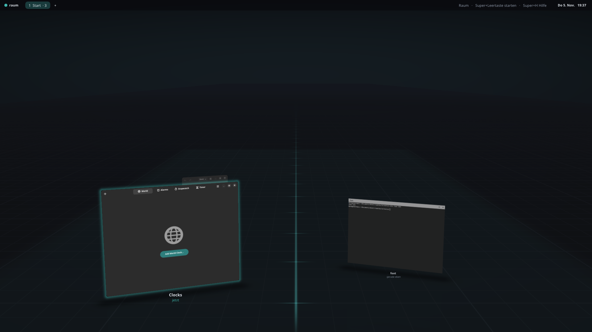
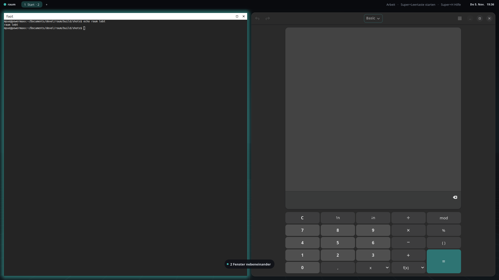
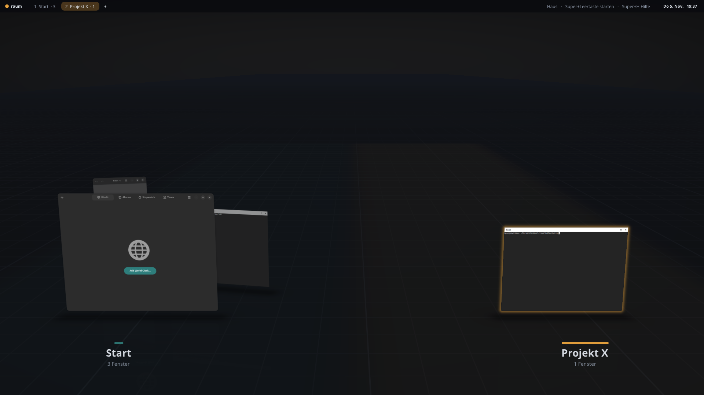

# raum

Ein 3D-Desktop für Linux: ein eigener Wayland-Compositor auf
[wlroots](https://gitlab.freedesktop.org/wlroots/wlroots), dessen Fenster die
[fitzel](../fitzel)-Engine in einen Raum zeichnet. Echte Programme (GTK, Qt,
Firefox, Chrome, foot, über Xwayland auch X11-Programme) laufen darin und
werden als Texturen im Raum angeordnet.



| Nebeneinander | Haus: alle Räume |
| --- | --- |
|  |  |

## Die Idee

Die dritte Dimension soll bei der Arbeit helfen. Effekt um seiner selbst
willen ist nicht das Ziel.

- **Vorn wird gearbeitet.** Das Fenster in Benutzung steht auf der
  Bildebene im Maßstab 1:1, Pixel für Pixel. Schrift ist genauso scharf wie
  auf jedem flachen Desktop.
- **Tiefe ist Zeit.** Was du vorher benutzt hast, wartet dahinter, und zwar
  umso weiter hinten, je länger es her ist. Zwei Fenster, die du kurz
  nacheinander benutzt hast, stehen nah beieinander. Eines von heute Morgen
  steht weit hinten. Der Abstand in der Tiefe wächst mit dem
  Logarithmus der vergangenen Zeit.
- **Zurücklehnen statt suchen.** Drei Stufen: *Arbeit* (1:1), *Raum* (die
  Kamera lehnt sich zurück, alle Fenster des Raums stehen als Galerie
  entlang einer Zeitachse am Boden, mit „jetzt“, „vor 12 min“, „vor 2 Stunden“)
  und *Haus* (alle Räume nebeneinander als kleine Dioramen).
- **Projekte als Räume.** Jedes Projekt bekommt einen eigenen Raum mit eigener
  Farbe und eigenem Verlauf. Ein Raum merkt sich, was in ihm gestartet wurde.
  Ist er leer, bietet er genau das zum Wiederstarten an.
- **Nebeneinander** heißt einfach: die zwei (oder drei) zuletzt benutzten
  Fenster vorn, jedes auf seinem festen Platz und in passender Größe.

## Starten

### Verschachtelt unter GNOME, im Vollbild oder im Fenster

```bash
~/.local/bin/raum --fullscreen
```

Ohne `--fullscreen` öffnet raum ein Fenster mit 1920×1080 (`--size 2560x1440`
für eine andere Größe). **Super+F11** schaltet jederzeit zwischen Vollbild und
Fenster um. Im Vollbild füllt raum den Monitor, auf dem GNOME es öffnet, in
dessen voller Auflösung. Der Eintrag „raum“ im Programmmenü (nach
`scripts/install.sh`) startet im Vollbild. Per Rechtsklick gibt es dort
„Im Fenster starten“. Super+Umschalt+E beendet raum, ebenso das Schließen
des Fensters.

- GNOME fragt beim ersten Mal, ob raum **Tastenkürzel blockieren** darf.
  Erlaube es, sonst landet Super bei GNOME (Übersicht) und nicht bei raum.
- Programme, die in raum gestartet werden, bekommen einen eigenen D-Bus. Sonst
  öffneten Programme mit nur einer Instanz (Nautilus, der Texteditor …) ihr
  Fenster drüben bei GNOME. `--shared-bus` schaltet das ab.
- Ein Browser, der in GNOME schon läuft, öffnet sein neues Fenster trotzdem
  dort, weil er sich über sein Profil findet. Zum Testen also einen zweiten
  Browser nehmen oder den laufenden vorher schließen.

Optionen: `raum --help`. Mit `-s 'foot'` (mehrfach möglich) wird nach dem Start
etwas ausgeführt.

### Als eigene Sitzung in GDM (experimentell)

```bash
~/Documents/devel/raum/scripts/install-session.sh
```

Das Skript kopiert `raum` und `raum-session` nach `/usr/local/bin` und den
Sitzungseintrag nach `/usr/share/wayland-sessions` (dafür braucht es sudo).
Danach abmelden und im Anmeldebildschirm über das Zahnrad „raum“ wählen.
raum übernimmt den Bildschirm dann über DRM/KMS und libinput. Das Log liegt
in `~/.local/state/raum/session.log`.

Dieser Weg ist gebaut, aber noch **nicht auf diesem Rechner ausprobiert**.
Verschachtelt läuft derselbe Code mit derselben Zeichnung, nur hinter einem
anderen wlroots-Backend. Mit zwei Grafikkarten (hier RTX 4090 und
Raphael-iGPU) lässt sich die Karte über `WLR_DRM_DEVICES=/dev/dri/cardN`
festlegen. Strg+Alt+F1…F12 wechselt die Konsole.

## Bedienung

Super ist die Windows-Taste. **Super+H** zeigt diese Liste auch in raum.

| Taste | |
| --- | --- |
| Super + Leertaste | Programm starten, in diesem Raum (Suche nach Name, auch auf Deutsch: „rech“, „uhr“, „dateien“) |
| Super + Enter | Terminal |
| Super + Tab | das Fenster dahinter nach vorn (noch einmal: weiter zurück in der Zeit) |
| Super + Umschalt + Tab | das älteste Fenster des Raums nach vorn |
| Super kurz tippen | zurücklehnen: Arbeit ↔ Raum |
| Super + ↑ / ↓, Super + Mausrad | Arbeit → Raum → Haus und zurück |
| Esc (zurückgelehnt) | wieder an die Arbeit |
| Super + ← / →, Super + 1 … 9 | Raum wechseln |
| Super + Umschalt + ← / →, + 1 … 9 | das Fenster in einen anderen Raum mitnehmen |
| Super + N / Super + R | neuer Raum / Raum umbenennen |
| Super + Rücktaste | leeren Raum entfernen |
| Super + P | 2, 3 oder 1 Fenster vorn nebeneinander |
| Super + F / Super + Umschalt + F | Fenster maximieren / Vollbild |
| Super + Q | Fenster schließen |
| Super + S | Bildschirmfoto nach `~/Bilder` (aus raums eigenem Renderer) |
| Super + F11 | verschachtelt: raum im Vollbild / im Fenster |
| Super + Umschalt + E | raum beenden |

Mit der Maus:

- Klick auf ein Fenster dahinter: holt es nach vorn. Der Klick selbst geht nicht
  an das Programm, damit nichts aus Versehen ausgelöst wird.
- Zurückgelehnt: Klick auf ein Fenster holt es nach vorn und kehrt zur Arbeit
  zurück. Das Mausrad geht in der Raum-Ansicht die Zeitachse entlang.
- Haus-Ansicht: ein Fenster auf einen anderen Raum ziehen, um es dorthin zu
  verschieben. Ein Klick auf einen leeren Raum öffnet ihn.
- Super + Ziehen verschiebt ein Fenster in seiner Ebene, Super + rechte
  Taste ändert seine Größe. Titelleisten (Ziehen, Doppelklick zum Maximieren)
  und Ränder zum Größeändern der Programme funktionieren wie gewohnt.
- Oben: die Räume als Chips (Klick wechselt, Doppelklick benennt um, „+“ macht
  einen neuen Raum), rechts Ebene und Uhr.

Räume, ihre Namen, Farben und was in ihnen gestartet wurde, stehen in
`~/.config/raum/state.json`.

## Bauen

Voraussetzungen: `sudo apt install libwlroots-0.19-dev foot`, außerdem ein
fitzel-Quellbaum unter `~/Documents/devel/fitzel`, der einmal mit seinem
`build/linux` gebaut wurde. raum baut die Engine als Unterprojekt und nimmt
die Quellen der Abhängigkeiten aus `fitzel/build/linux/_deps`, lädt also
nichts neu herunter.

```bash
cmake -S ~/Documents/devel/raum -B ~/Documents/devel/raum/build -G Ninja
```

```bash
cmake --build ~/Documents/devel/raum/build --target raum
```

`scripts/install.sh` macht beides und installiert für diesen Benutzer:
`~/.local/bin/raum`, das Icon und einen Menüeintrag.

## Prüfen

```bash
~/Documents/devel/raum/tests/run.sh
```

startet raum **headless** (`WLR_BACKENDS=headless`, kein Fenster, kein
Host-Desktop nötig) mit `tests/tour.script`. Dabei laufen echte Programme
(foot, Rechner, Uhren). Tasten und Klicks gehen über eine virtuelle Tastatur
und den normalen Eingabepfad, also genau den Weg echter Eingaben. Jeder
Schritt legt ein Bildschirmfoto aus raums eigenem Renderer in `build/shots/`
ab. Die Skriptsprache:

`wait S` · `spawn BEFEHL` · `key super+shift+Left` · `type Text\n` ·
`pointer X Y` · `click X Y` · `press` / `release` · `drag X0 Y0 X1 Y1` ·
`level work|room|house` · `room N` · `newroom NAME` · `split N` · `cycle` ·
`launcher` · `help` · `close` · `focus APPID` · `move N` · `fullscreen` · `shot DATEI` ·
`outshot DATEI` (den Puffer, den die Ausgabe wirklich bekam) · `quit`

`raum --script DATEI` geht auch verschachtelt. Zur Fehlersuche gibt es
`RAUM_DEBUG=1` (wlroots-Log), `RAUM_DEBUG_CANVAS=1` (Commits und Fensterbilder),
`RAUM_DEBUG_HUD=1` (Tasten an die Oberfläche) und `RAUM_NO_INHIBIT=1`
(verschachtelt nicht um die Tastenkürzel bitten).

## Wie es gebaut ist

```
wlroots        Backend (verschachtelt: Wayland-Fenster; Sitzung: DRM + libinput),
               Protokolle (xdg-shell, Xwayland, dmabuf, explizite Sync, Zwischenablage …)
   │  Puffer der Clients              Swapchain-Puffer der Ausgabe
   ▼                                  ▼
Gpu            eigener OpenGL-4.3-Kontext auf wlroots' EGL-Display;
               dmabuf → EGLImage → Textur bzw. Framebuffer
   ▼
fitzel         rhi::Device auf diesem Kontext (createExternalDevice), Shader, Meshes,
               Render-Targets, Kamera, Dear ImGui
   ▼
Desk           Räume, Ebenen, Verlauf, Kamera; Pixel ↔ Fensterpixel (Picking)
DeskRenderer   Himmel, Boden (Raster, Zeitachse, weiche Schatten), Spiegelung,
               je Fenster ein Bild aus allen seinen Oberflächen (Popups, Subsurfaces)
Hud            Leiste, Titel und Zeiten, Starter, Hilfe, Hinweise (ImGui)
```

Ein paar Entscheidungen dahinter:

- **Das Fenster beim Host macht raum selbst** (`HostWindow`, als Ausgabe an
  wlroots übergeben mit `wlr_wl_output_create_from_surface`). Nur so kann raum
  um Vollbild bitten, denn die Toplevel, die wlroots selbst anlegt, bleibt
  intern.
- **Fitzel zeichnet, wlroots stellt dar.** raum benutzt wlroots' Renderer nicht
  zum Zeichnen. Es lässt sich von wlroots nur die Puffer der Swapchain geben,
  importiert sie als Framebuffer in den eigenen GL-Kontext und reicht sie zurück.
  Deshalb ist der Code verschachtelt und als Sitzung derselbe.
- **1:1 ist Geometrie, kein Sonderfall.** Weltmaße sind die Pixel der
  Bildebene. Die Kamera steht auf der Arbeitsebene genau so weit weg, dass eine
  Einheit bei z = 0 ein Bildschirmpixel ist. Vordere Fenster liegen mit ihren
  Ecken auf ganzen Pixeln.
- **Synchronisation.** Der NVIDIA-Treiber kennt keine implizite
  Synchronisation. raum bietet `linux-drm-syncobj` an und lässt die GPU auf
  den Fence des Clients warten, bevor es dessen Puffer liest. Clients ohne das
  Protokoll bekommen den impliziten Fence des dmabuf.
- **Eigene Pufferreferenz.** Ohne wlroots-Renderer gibt wlroots den Puffer
  einer Oberfläche direkt nach dem Commit frei. raum hält ihn selbst, bis der
  nächste kommt.

### Was dafür in fitzel geändert wurde

Nur in `engine/src/rhi` und `engine/include/fitzel/rhi` sowie eine Zeile im
CMake von fitzel:

- `rhi::createExternalDevice()`: ein OpenGL-Gerät auf einem Kontext, den das
  Programm selbst gemacht hat, ohne GLFW-Fenster.
- `Device::setWindowFramebuffer()`: Was als „Fensterframebuffer“ gilt, ist
  jedes Frame ein anderer Puffer.
- `Device::adoptTexture()`: Eine GL-Textur, die das Programm aus einem
  EGLImage gemacht hat, wird zu einem gewöhnlichen `TextureHandle`.
- Das Versions-Stamping in fitzels `CMakeLists.txt` benutzt
  `CMAKE_CURRENT_SOURCE_DIR`, damit fitzel als Unterprojekt baut.

## Grenzen dieses ersten Stands

- Nur **ein Bildschirm**. Weitere Ausgaben bleiben in einer Sitzung dunkel.
  Skalierung 1, keine gebrochene Skalierung.
- Kein layer-shell: Panels, Docks und Benachrichtigungs-Popups anderer
  Programme erscheinen nicht. Kein Eingabemethoden-Protokoll (IME).
- Fenster tragen ihre eigenen Titelleisten (CSD). Programme, die nur
  serverseitige Dekorationen kennen, haben in raum keine.
- Xwayland deckt die Grundlagen ab: Fenster, Menüs (override-redirect),
  Fokus, Größe. Ziehen per X11-Titelleiste fehlt noch.
- Fensterinhalt und Oberfläche sind getestet, headless und verschachtelt,
  mit foot, GTK4-Programmen und glxgears über Xwayland. Tasten und Klicks
  kamen dabei aus Skripten über denselben Eingabeweg wie echte Geräte. Von
  Hand mit echter Maus und Tastatur unter GNOME ist raum noch nicht
  ausprobiert. Die GDM-Sitzung ist ungetestet (siehe oben).
